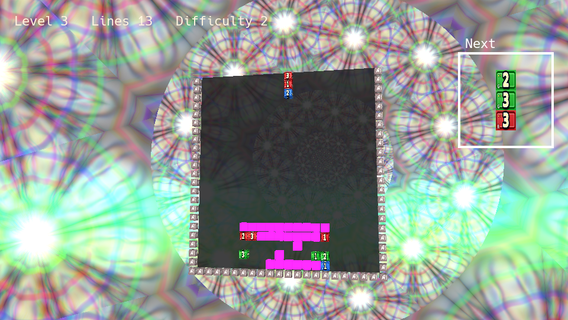

# Puzzle Drop for mxvk_wrap

Python port of `examples/puzzle_drop`: a 20×22 3D block puzzle with the original
cube model, numbered color textures, eight shuffled level backgrounds, intro
shader, blue Matrix rain, next-piece preview, keyboard and gamepad controls.

From `python-examples/mxvk_wrap/examples`, run:

```sh
PYTHONPATH=../../../build python3 puzzle_drop/main.py
PYTHONPATH=../../../build python3 -m puzzle_drop -r 1920x1080 --fullscreen
```

Use the directory containing your built `mxvk_ext` for `PYTHONPATH`; an installed
extension works without it. Requires the existing MXVK Vulkan/SDL3 runtime,
NumPy, and Pillow (`python3 -m pip install -r puzzle_drop/requirements.txt`).
Rebuild the extension from the current source to include the accompanying
model descriptor reuse fix. Older builds rewrite already bound descriptor
sets when drawing repeated cube textures. The extension must expose
`AbstractModel.render_with_push_constants`.

From the repository root:

```sh
cmake --build build --target mxvk_ext -j
```

The portable launcher also accepts the script path. From `python-examples`:

```sh
python3 run_mxvk.py mxvk_wrap/examples/puzzle_drop/main.py
```

The first launch compiles the bundled GLSL sources using `glslc` from the Vulkan
SDK. Later launches compile only missing or changed shaders. To prepare them:

```sh
python3 puzzle_drop/compile_shaders.py
```

Options: `-r WIDTHxHEIGHT`, `-f` / `--fullscreen`, `--no-vsync`, `--validation`.

The intro fades into play automatically. Enter/Space skips the fade. Press
1/2/3 to start a fresh game at the chosen difficulty. Match three numbered blocks
of the same color in 1–2–3 or 3–2–1 order, horizontally, vertically, or diagonally.
The flashing neon block is a wildcard. Every six matches advances the level,
up to eight. Difficulty controls the piece fall interval (0.86/0.68/0.50 seconds).

| Keyboard | Action |
| --- | --- |
| Left / Right | Move piece |
| Down | Soft drop |
| Up | Cycle the three block types |
| Z / X | Rotate left / right; press again to return to vertical |
| W / A / S / D | Rotate board |
| Page Up / Page Down | Zoom in / out |
| Enter / Space | Skip intro; restart after game over |
| 1 / 2 / 3 | Reset with difficulty 1 / 2 / 3 |
| Escape | Quit |

Gamepad: South/A or Start skips the intro and restarts after game over.
During play, D-pad Left/Right or left stick moves; D-pad Down or left stick down
soft drops; D-pad Up cycles blocks. South/A rotates right, West/X rotates left,
East/B hard drops, right stick rotates the board, shoulders zoom, and Back quits.
Controllers are discovered at startup and after connection changes.

The port retains the native ordered matching scan, one match per processing
tick, one settled cell falling per tick, wildcard substitution, 51-step flashing
clear lifetime, collision rules, level progression, and game-over behavior.
Processing runs at the original 18 ms interval. The C++ rain helper is recreated
with cached Pillow CJK glyphs and a dynamic `mx.Sprite`; its glow and font
rasterization differ slightly. The original piece/background/intro GLSL runs
unchanged. Models and fonts are managed by `mx.App` and released before the window.

Run the rules tests without Vulkan or the native extension:

```sh
python3 -m unittest discover -s puzzle_drop -v
```

With the extension available and access to a display, run the optional Vulkan
rendering regression (including repeated texture draws and menu transitions):

```sh
MXVK_RENDER_TESTS=1 PYTHONPATH=../../../build python3 -m unittest discover -s puzzle_drop -p test_rendering.py -v
```


